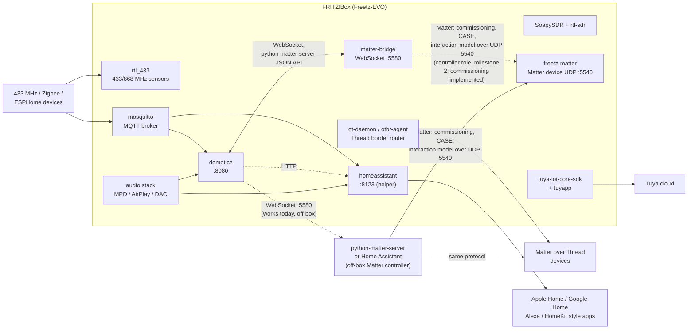

# Freetz-EVO — A complete home automation subsystem

A FRITZ!Box is already the device that is on 24/7 in most homes, it already holds the DECT base station, it already knows whether the WAN link is up, and it already has USB ports for radio sticks and storage. Freetz-EVO turns it into the *edge* of a home automation installation: the place where radios are attached, where Matter and MQTT endpoints live, and where the always-on services run.

This document describes the whole subsystem: what is packaged, what it can do, how the pieces fit together and which parts are verified on real hardware.

## The complete picture

Read the diagram by keeping the **two directions** apart, because the protocols on the two hops are different:

| Chain | Hops | State |
|---|---|---|
| Domoticz → local freetz-matter, no off-box software | `domoticz` → WebSocket TCP 5580 → `matter-bridge` → Matter/CASE UDP 5540 → `freetz-matter` | Native single-daemon controller: automatic local PASE/CASE, real attributes/commands/subscriptions and stable fabric. Host integration tested; router temperature/audio and boot testing remain. No multicast discovery or Wi-Fi/Thread provisioning. |
| Domoticz → Matter devices, today | `domoticz` —WebSocket/JSON API→ `python-matter-server` (off-box, glibc) —Matter (UDP 5540)→ device | works |
| Any Matter controller → the FRITZ!Box itself | controller —Matter (UDP 5540)→ `freetz-matter` | works: `freetz-matter` is a Matter *device* (rs-matter), independent of both `matter-bridge` and Domoticz |

The WebSocket hop exists because that is how the reference server exposes its API; Matter itself uses UDP and a TLV interaction model. `matter-bridge` embeds the WebSocket API and controller; `freetz-matter` is the accessory. `matter-bridge-ctl` is an optional diagnostic CLI, not a second required service.

## Domoticz — the fully built-in hub

[`domoticz`](make/domoticz.md) 2026.4 is a complete port (SubGHz/433, MQTT, Lua, Python, I2C/SPI, USB): a 12 MB stripped MIPS binary plus a 21 MB payload (`www`, `dzVents`, `plugins`, `scripts`). It is the only hub in the tree that runs entirely on the router without external dependencies, which is why it is the natural partner of `matter-bridge`.

* web interface on port 8080, `-userdata` on external storage, `-log` in `/var/log`;
* async boot start: the init script waits for the USB stick in a background subshell, the boot sequence is never blocked;
* the Matter hardware entry connects to `ws://127.0.0.1:5580/ws`, so the bridge and the hub can live on the same box;
* dependency set built and verified: Boost 1.87 thread, libmosquitto, Lua 5.4, Python 3.14, SQLite, OpenSSL, libusb, libcurl.

## Matter without Node.js

The reference Matter controllers are `matterjs-server` (Node.js) and `python-matter-server` (Python): both embed the CHIP SDK, which is not portable to a uClibc/MIPS router. Freetz-EVO therefore ships a **native** implementation of the WebSocket API these clients expect:

* [`matter-bridge`](make/matter-bridge.md) — native Rust/rs-matter controller with WebSocket API on loopback port 5580. Automatic local commissioning, PASE/CASE, reads/writes, actuator commands, subscription reports and restart recovery are covered by a real host integration test. See [simple setup and limitations](make/matter-bridge.md).
* [`openthread`](make/openthread.md) — `ot-daemon` and `ot-ctl` for Thread networks.
* [`ot-br-posix`](make/ot-br-posix.md) — `otbr-agent`, the Thread border router that connects a Thread mesh to the LAN (built: `otbr-agent` 2.4 MB + `ot-ctl`, compiled from the same source tree through a symlinked `third_party/openthread/repo`).

The practical consequence: a Domoticz or Home Assistant instance can talk to a Matter setup where **no Node.js process runs on the box**, and where the Thread infrastructure is native.

## Home Assistant — a setup helper

[`homeassistant`](make/homeassistant.md) ships the **installation helper** (`/usr/bin/ha-setup`), the modconf configuration set and the autorun init script, plus the Kconfig selection of the Python modules and libraries Home Assistant needs (*Minimal* and *Full* profiles). The application itself is installed on demand on external storage (`pip --prefix`, no `venv` required) and can be pinned or upgraded with one command.

This is deliberate: everyone knows that on a router with 256–512 MB RAM the honest recommendation is to run Home Assistant on a NAS or a Raspberry Pi (with swap, it also starts on the box). What the package *does* provide is a reproducible way to get the interpreter stack right, to keep the database off the flash, and to autostart the service in the freetz way.

## The MQTT backbone

[`mosquitto`](make/mosquitto.md) provides the broker (`FREETZ_PACKAGE_MOSQUITTO`) and the client tools (`FREETZ_PACKAGE_MOSQUITTO_CLIENTS`). It is the lowest-common-denominator glue of the ecosystem:

* ESPHome, Tasmota, Zigbee2MQTT, Shelly and most DIY sensors publish to it;
* both Domoticz and Home Assistant consume it directly;
* it is also the bridge towards cloud-free automations (Node-RED on another host, scripts on the box).

The package is built without the HTTP API to keep the broker small.

## Radio sensors: 433 MHz and SDR

* [`rtl_433`](make/rtl_433.md) — decodes hundreds of 433/868 MHz protocols (temperature/humidity sensors, door contacts, remote controls, energy meters). Built with `SoapySDR` support and OpenSSL, so both USB DVB-T sticks and SDR frontends work.
* [`soapyrtlsdr`](make/soapyrtlsdr.md) + [`rtl-sdr`] — the driver layer, with the kernel driver `dvb_usb_rtl28xxu` blacklisted when needed.
* decoded sensors are published to MQTT and/or written to files, and are then visible to Domoticz and Home Assistant. This is the cheapest way to get real automation data on a router: one USB stick, no cloud, no hubs.

## Cloud devices: Tuya

[`tuya-iot-core-sdk`](make/tuya-iot-core-sdk.md) and [`tuyapp`](make/tuyapp.md) bring the Tuya IoT platform to the box: cloud-connected plugs, bulbs and sensors can be driven locally through the SDK, and `tuyapp` gives a CLI to talk to them. Useful when a device cannot be flashed with local firmware.

## Audio as an actuator

The [audio subsystem](AUDIO.md) is not a separate world: `MPD`, `mpc` and the `mpd-mpc` CGI, the AirPlay receiver `shairport-sync`, `go-librespot` (Spotify Connect) and the USB-DAC layer (`ja11-config`, `hidws`) turn the FRITZ!Box into a **speaker**, i.e. the actuator that home automation scenarios want to address ("announce the doorbell on the kitchen speaker", "play a playlist when presence is detected"). Volume, play/pause and source selection are all scriptable on the box and callable from Domoticz/Home Assistant or from a Matter controller through `OnOff`/`LevelControl`.

## ⭐ Exposing Freetz-EVO as a Matter device

This is the reverse direction, and it is what makes a Matter setup testable **without owning a single Matter device**: the FRITZ!Box itself becomes a Matter accessory that any controller can commission.

### What the box can offer

| FRITZ!Box data source | What it contains | Natural Matter representation |
|---|---|---|
| `/cgi-bin/status/mod/box_info` | CPU temperature, uptime, DECT/telephony state, WLAN state, power, connection status | `Temperature Measurement` (0x0402), `Boolean State` (0x0045) for line/telephony state, `Occupancy Sensing` (0x0406) for presence, `Basic Information` (0x0028) + `General Diagnostics` (0x0033) for uptime |
| `/cgi-bin/status/mod/info` | model, firmware version, serial, build | `Basic Information` (0x0028) and `Software Diagnostics` (0x0034) — the box shows up with a real name, vendor and firmware version |
| audio devices (speakers, mic) | volume, playback state, source, DAC features | `On/Off` (0x0006) + `Level Control` (0x0008) + `Media Playback` (0x0506) on a `Smart Speaker`/`Speaker` device type |
| `rtl_433` sensors | temperature, humidity, contact, leak, smoke, energy | `Temperature Measurement` (0x0402), `Relative Humidity` (0x0405), `Boolean State` (0x0045, contact/leak), and the corresponding alarm clusters |
| storage and system | free space on the USB disk, CPU load, memory | `Boolean State` (0x0045) for low-space warnings, `Electrical Power Measurement` (0x0B04) style numeric attributes for load/space |

Every entity above can also be exposed as a custom attribute, because the attribute path is just `endpoint/cluster/attribute` — the bridge relays whatever the agent stores.

### Further suggestions (all implementable with the same pattern)

| Idea | Why it is useful | Cluster |
|---|---|---|
| WLAN on/off, guest WLAN on/off | the oldest home automation trick on a FRITZ!Box: cut WiFi when nobody is home | `On/Off` |
| Momentary "reboot" / "reconnect WAN" button | expose recovery actions to a dashboard or a scene | `Switch` (0x003B) / `On/Off` with automatic reset |
| DECT/handset state, answering machine | drive automations on ringing ("flash the lights when the phone rings") | `Boolean State`, `On/Off` |
| Call log entries | presence/activity detection without cameras | custom attributes + events |
| DSL/mobile throughput and line quality | dashboards and alerts on degradation | `Electrical Power Measurement`, `Boolean State` |
| USB storage usage | prevent the recorder/DB from filling the stick | numeric attribute + `Boolean State` |
| Network presence (associated clients) | occupancy detection for heating/lighting | `Occupancy Sensing` (0x0406) |
| Doorbell / door sensor via 433 MHz or GPIO | the classic automation trigger | `Boolean State`, `Generic Switch` |
| Temperature of the SoC as a safety trigger | the box throttles when hot: useful to alert | `Temperature Measurement` + events |
| LED / display of the box | hard, vendor specific, not recommended | — |

The **opposite** mapping uses the native controller embedded in `matter-bridge` to drive a known-address Matter accessory. For full discovery and Wi-Fi/Thread commissioning workflows, `python-matter-server` on a glibc host remains the broader alternative. See [MATTER.md](MATTER.md) and [matter-bridge.md](make/matter-bridge.md) for the implemented scope.

### Implementation status

`project-chip/rs-matter` is the only realistic Rust implementation for the "box as a Matter device" direction: Matter 1.6, `no_std`-capable, pure Rust, with examples for `onoff_light`, `dimmable_light`, `speaker`, `thermostat` and — most relevant here — a **`bridge.rs`** example that exposes non-Matter devices through a Matter bridge.

That direction is now packaged as **`freetz-matter`** ([package page](make/freetz-matter.md)): the crate pins `rs-matter` at revision `7d5684f` and exposes three endpoints on the box itself — a Temperature Sensor fed by the same sensors the `box_info` page reads, a Smart Speaker that drives ALSA through `amixer`, and root `BasicInformation` carrying the real model, FRITZ!OS version, AVM revision and LAN MAC.

Making that dependency graph build for uClibc/MIPS needed three fixes, two of which are now shared with the other Rust packages in the tree:

* rustix on the **libc backend without `linux_raw_dep`** (what rs-matter pulls) — `linux_raw_sys` is not linked there, so the missing uClibc items are substituted at their use sites instead of being declared in rustix's private `c` module. New macro `RUSTIX_APPLY_UCLIBC_PATCHES_LIBC_NORAW__INT` in `make/include/650-rust-cargo.mk`.
* `getrandom` — uClibc's `libc` crate has no `getrandom()`, so the `SYS_getrandom` syscall fallback is applied (existing shared macro).
* a memory-conservative Cargo profile — rs-matter's IDL codegen produces ~30 MB of Rust, and the upstream profile (fat LTO + `codegen-units=1`) gets the single `rustc` job SIGKILLed on a 4-core/8 GB build host. The package builds with `opt-level = 1`, `lto = false`, `codegen-units = 256`.

The remaining work on this path is verification on a real box with a real controller (commissioning the FRITZ!Box from Apple Home/Google Home/Home Assistant), plus the extra endpoints listed above, each of which is a small handler over data Freetz-EVO already collects.

## Package summary

| Package | Version | Role | Status |
|---|---|---|---|
| [`domoticz`](make/domoticz.md) | 2026.4 | full hub, web UI on 8080 | built, verified, installable |
| [`matter-bridge`](make/matter-bridge.md) | 0.1 | native Matter WebSocket API, port 5580 | built, protocol verified against upstream |
| [`openthread`](make/openthread.md) | 2026.10.0 | `ot-daemon`, `ot-ctl` | built, verified |
| [`ot-br-posix`](make/ot-br-posix.md) | 2026.10.0 | Thread border router (`otbr-agent`) | built, verified (`otbr-agent` 2.4 MB + `ot-ctl`) |
| [`mosquitto`](make/mosquitto.md) | 2.x | MQTT broker + client tools | built, verified |
| [`homeassistant`](make/homeassistant.md) | 1.0 (helper) | setup script + autorun for Home Assistant | helper shipped, installs on demand |
| [`freetz-matter`](make/freetz-matter.md) | 0.1 | the box **as** a Matter device (rs-matter, no Node.js) | built end-to-end: `rs-matter` cross-compiles for MIPS/uClibc, the package installs a 4.5 MB binary linking only `libc`/`ld-uClibc`/`libgcc_s`; on-box commissioning not tested yet |
| [`rtl_433`](make/rtl_433.md) | 25.02 | 433/868 MHz sensor decoding | built, verified |
| [`soapyrtlsdr`](make/soapyrtlsdr.md) | 0.3.3 | SDR front end for RTL sticks | built, verified |
| [`tuya-iot-core-sdk`](make/tuya-iot-core-sdk.md) | 0.1 | Tuya cloud devices | built, verified |
| [`tuyapp`](make/tuyapp.md) | 0.1 | Tuya CLI | built, verified |
| [`boost`](make/boost.md) | 1.87.0 | thread/pool library required by Domoticz | built, verified |

**Externalization**: every package in the table (and the `rtl-sdr`, `soapysdr` and `boost` libraries) can be moved to external storage from the *External* menu, which keeps the firmware image untouched — the whole point of running a home automation stack on a device with a few megabytes of free flash. Declared files, verified against the built artifacts:

| Entry | Files moved to external storage |
|---|---|
| `domoticz` | `/usr/bin/domoticz`, `/usr/share/domoticz` (daemon + 21 MB payload) |
| `matter-bridge` | `/usr/bin/matter-bridge` |
| `ot-br-posix` | `/usr/sbin/otbr-agent`, `/usr/sbin/ot-ctl` |
| `openthread` | `/usr/bin/ot-daemon`, `/usr/bin/ot-ctl` |
| `freetz-matter` | `/usr/bin/freetz-matter` |
| `homeassistant` | `/usr/bin/ha-setup` (Home Assistant itself is installed to external storage by the helper) |
| `rtl_433` | `/usr/bin/rtl_433` |
| `soapyrtlsdr` | `/usr/lib/SoapySDR/modules0.8/libsoapyrtlsdr.so` |
| `tuya-iot-core-sdk` | the four demo binaries |
| `tuyapp` | the five `tuya_*` tools and the sample device list |
| `rtl-sdr` (lib) | `${FREETZ_LIBRARY_DIR}/librtlsdr.so.2.0.3` |
| `soapysdr` (lib) | `${FREETZ_LIBRARY_DIR}/libSoapySDR.so.0.8.1` |
| `boost` (lib) | `${FREETZ_LIBRARY_DIR}/libboost_{thread,system}.so.1.87.0` |

`tools/check-external-files.sh` and `tools/check-external-wiring.sh` verify the declarations (file existence in the build output and Kconfig wiring), and `make` itself performs the move at image assembly; externalizing a library also defers the services that depend on it until external storage is mounted (handled by `tools/external`).

## Design constraints and caveats

* **Storage**: Domoticz, Home Assistant and the recorder databases must live on ext4 external storage, never on the flash.
* **Memory**: `domoticz` runs in ~40–80 MB, Home Assistant needs much more; Thread/Matter infrastructure is small (a few MB). Swap is strongly advised.
* **No FPU** on several SoCs: avoid DSP-heavy integrations, see [AUDIO.md](AUDIO.md).
* **Boot**: every service waits for its storage in a **background subshell**; automations must never delay the boot sequence.
* **Matter controller role**: embedded in the single `matter-bridge` daemon. Domoticz connects to `127.0.0.1:5580`; freetz-matter commissioning is automatic when its commissioning window is open. No external server or diagnostic CLI is required for this local chain.
* **Verification**: the Matter bridge was validated with the upstream reference dataclasses and with the Domoticz driver's own parsing rules, on a host build of the same sources that are cross-compiled for MIPS.

## See also

* [MATTER.md](MATTER.md) — Node-free Matter: protocol, architecture, verification
* [AUDIO.md](AUDIO.md) — the audio subsystem used as an actuator
* [DISK-MGMT.md](DISK-MGMT.md) — storage preparation (ext4, swap, mounts)
* [NEW-PACKAGES.md](NEW-PACKAGES.md) — the package changelog
