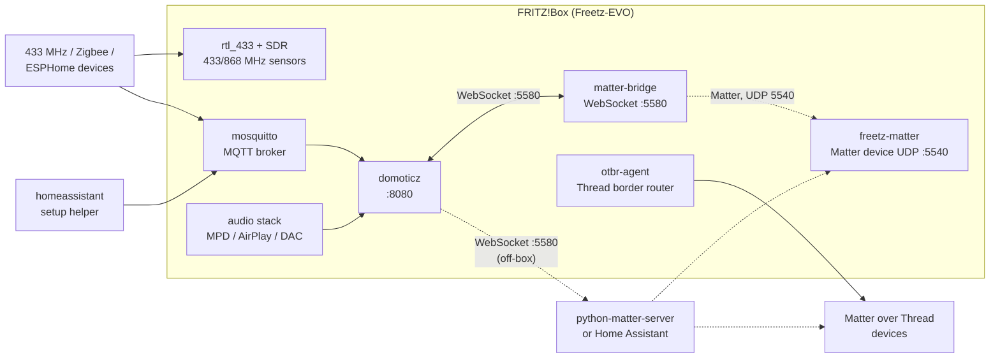

# Freetz-EVO — A complete home automation subsystem

A FRITZ!Box is already the device that is on 24/7 in most homes, it already holds the DECT base station, it already knows whether the WAN link is up, and it already has USB ports for radio sticks and storage. Freetz-EVO turns it into the *edge* of a home automation installation: the place where radios are attached, where Matter and MQTT endpoints live, and where the always-on services run.

This document describes the whole subsystem: what is packaged, what it can do, how the pieces fit together and which parts are verified on real hardware.

## The complete picture

Three roles, in short:

* **hub** — [`domoticz`](make/domoticz.md) is the only hub that runs entirely on
  the box: web UI on port 8080, MQTT, Z-Wave, 433 MHz, Matter and the audio stack;
* **Matter** — [`matter-bridge`](make/matter-bridge.md) serves the WebSocket API
  Domoticz expects and acts as the controller, [`freetz-matter`](make/freetz-matter.md)
  is the accessory that turns the box into a Matter device. The off-box
  `python-matter-server` on a glibc host remains a valid alternative, and any
  Matter controller can commission the accessory directly;
* **radios and glue** — [`mosquitto`](make/mosquitto.md) for MQTT,
  [`rtl_433`](make/rtl_433.md) with [`soapyrtlsdr`](make/soapyrtlsdr.md) for
  433/868 MHz sensors, [`telldus`](make/telldus.md) for the Tellstick
  (433 MHz, receiver *and* transmitter), [`openthread`](make/openthread.md) and
  [`ot-br-posix`](make/ot-br-posix.md) for Thread, the [audio subsystem](AUDIO.md)
  as actuator, [`tuya-iot-core-sdk`](make/tuya-iot-core-sdk.md) for cloud devices
  and Home Assistant as an optional helper.

The WebSocket hop exists because that is how the reference server exposes its
API; Matter itself uses UDP and a TLV interaction model. Details in
[MATTER.md](MATTER.md).

## Domoticz — the fully built-in hub

[`domoticz`](make/domoticz.md) 2026.4 is a complete port (Z-Wave, SubGHz/433, MQTT, Lua, Python, I2C/SPI, USB). It is the only hub in the tree that runs entirely on the router without external dependencies, which is why it is the natural partner of `matter-bridge`.

* web interface on port 8080, `-userdata` on external storage, `-log` in `/var/log`;
* async boot start: the init script waits for the USB stick in a background subshell, the boot sequence is never blocked;
* the Matter hardware entry connects to `ws://127.0.0.1:5580/ws`, so the bridge and the hub can live on the same box;
* radio drivers compiled in, not loaded as Python plugins: `libopenzwave` 1.6 for Z-Wave and `libtelldus-core` 2.1.1 for the Tellstick, so a USB stick is enough to see real devices;
* **36 Python plugin packages** install into `<approot>/plugins`, without touching the Domoticz build: energy and PV ([`homewizard-p1`](make/domoticz-homewizard-p1.md), [`ada-p1-meter`](make/domoticz-ada-p1-meter.md), [`hw-watermeter`](make/domoticz-hw-watermeter.md), [`hw-energysocket`](make/domoticz-hw-energysocket.md), [`growatt`](make/domoticz-growatt.md), [`goodwe`](make/domoticz-goodwe.md), [`fronius`](make/domoticz-fronius.md), [`alphaess`](make/domoticz-alphaess.md), [`apc-ups`](make/domoticz-apc-ups.md), [`nut-ups`](make/domoticz-nut-ups.md), [`linky`](make/domoticz-linky.md)), presence and cameras ([`fritz-presence`](make/domoticz-fritz-presence.md), [`home-presence`](make/domoticz-home-presence.md), [`dahua-vto`](make/domoticz-dahua-vto.md), [`camera-bridge`](make/domoticz-camera-bridge.md)), climate ([`dsvt`](make/domoticz-dsvt.md), [`ebusd`](make/domoticz-ebusd.md), [`daikin`](make/domoticz-daikin.md), [`quatt`](make/domoticz-quatt.md), [`maxcube`](make/domoticz-maxcube.md), [`ir-climate-controller`](make/domoticz-ir-climate-controller.md)) and actuation/AV/utility ([`ev-charge-control`](make/domoticz-ev-charge-control.md), [`denon`](make/domoticz-denon.md), [`onkyo`](make/domoticz-onkyo.md), [`yamaha`](make/domoticz-yamaha.md), [`sony-bravia`](make/domoticz-sony-bravia.md), [`synology`](make/domoticz-synology.md), [`yi-hack`](make/domoticz-yi-hack.md), [`govee`](make/domoticz-govee.md), [`milight`](make/domoticz-milight.md), [`moonphases`](make/domoticz-moonphases.md), [`wan-ip-checker`](make/domoticz-wan-ip-checker.md), [`wudirect`](make/domoticz-wudirect.md), [`knmi`](make/domoticz-knmi.md), [`smogtok`](make/domoticz-smogtok.md), [`theme-manager`](make/domoticz-theme-manager.md)); most of them are standard-library only, and the ones that are not pull `python3-requests`, `python3-paho-mqtt` or `python3-fritzconnection`. They are all moved to external storage together with `/usr/share/domoticz`;
* dependency set built and verified: Boost 1.87 thread, libmosquitto, Lua 5.4, Python 3.14, SQLite, OpenSSL, libusb, libcurl.

## Matter without Node.js

The reference Matter controllers are `matterjs-server` (Node.js) and `python-matter-server` (Python). Freetz-EVO therefore ships a **native** implementation of the WebSocket API these clients expect:

* [`matter-bridge`](make/matter-bridge.md) — native Rust/rs-matter controller with WebSocket API on loopback port 5580. Automatic local commissioning, PASE/CASE, reads/writes, actuator commands, subscription reports and restart recovery are covered by a real host integration test. See [simple setup and limitations](make/matter-bridge.md).
* [`openthread`](make/openthread.md) — `ot-daemon` and `ot-ctl` for Thread networks.
* [`ot-br-posix`](make/ot-br-posix.md) — `otbr-agent`, the Thread border router that connects a Thread mesh to the LAN (built: `otbr-agent` 2.4 MB + `ot-ctl`, compiled from the same source tree through a symlinked `third_party/openthread/repo`).

The practical consequence: a Domoticz or Home Assistant instance can talk to a Matter setup where **no Node.js process runs on the box**, and where the Thread infrastructure is native.

### Upstream projects behind Thread and Matter

| Upstream project | Size (repository only) | Status in Freetz-EVO | What actually runs on the box |
|---|---|---|---|
| [`openthread/openthread`](https://github.com/openthread/openthread) (BSD-3-Clause) | 127 MB | **ported** → [`openthread`](make/openthread.md) 2026.10.0, pinned tag archive plus `mbedtls` and `mbedtls-framework` at fixed commits | `ot-daemon` and `ot-ctl` in `/usr/bin`: the Thread 1.4.0 stack (IPv6, 6LoWPAN, IEEE 802.15.4 MAC security, mesh routing, border router support) |
| [`openthread/ot-br-posix`](https://github.com/openthread/ot-br-posix) (BSD-3-Clause) | 31 MB | **ported** → [`ot-br-posix`](make/ot-br-posix.md) 2026.10.0, compiled from the *same* OpenThread source tree through a symlinked `third_party/openthread/repo` | `otbr-agent` (2.4 MB stripped) + `ot-ctl`, init script `rc.otbr`, configuration in `/mod/etc/default.otbr/otbr.cfg` |

## Home Assistant — a setup helper

[`homeassistant`](make/homeassistant.md) ships the **installation helper** (`/usr/bin/ha-setup`), the modconf configuration set and the autorun init script, plus the Kconfig selection of the Python modules and libraries Home Assistant needs (*Minimal* and *Full* profiles). The application itself is installed on demand on external storage (`pip --prefix`, no `venv` required) and can be pinned or upgraded with one command.

This is deliberate: everyone knows that on a router with 256–512 MB RAM the honest recommendation is to run Home Assistant on a NAS or a Raspberry Pi (with swap, it also starts on the box). What the package *does* provide is a reproducible way to get the interpreter stack right, to keep the database off the flash, and to autostart the service in the freetz way.

## The MQTT backbone

[`mosquitto`](make/mosquitto.md) provides the broker (`FREETZ_PACKAGE_MOSQUITTO`) and the client tools (`FREETZ_PACKAGE_MOSQUITTO_CLIENTS`). It is the lowest-common-denominator glue of the ecosystem:

* ESPHome, Tasmota, Zigbee2MQTT, Shelly and most DIY sensors publish to it;
* both Domoticz and Home Assistant consume it directly;
* it is also the bridge towards cloud-free automations (Node-RED on another host, scripts on the box).

The package is built without the HTTP API to keep the broker small.

## Radio sensors: 433 MHz and SDR

* [`rtl_433`](make/rtl_433.md) — decodes hundreds of 433/868 MHz protocols (temperature/humidity sensors, door contacts, remote controls, energy meters). Built with `SoapySDR` support and OpenSSL, so both USB DVB-T sticks and SDR frontends work.
* [`soapyrtlsdr`](make/soapyrtlsdr.md) + [`rtl-sdr`] — the driver layer, with the kernel driver `dvb_usb_rtl28xxu` blacklisted when needed.
* [`telldus`](make/telldus.md) — the `telldusd` daemon and `tdtool` for the Tellstick USB transceiver: it both decodes the classic 433 MHz protocols (temperature, humidity, self-learning switches) and **transmits**, so the same stick can read a sensor and switch a socket. Configuration is a `tellstick.conf` edited from the web interface, devices learned at run time are kept in `/mod/etc/conf`. Domoticz talks to it through `libtelldus-core`, so a Tellstick shows up as a native hardware entry; a Z-Wave USB stick shows up through the built-in OpenZWave support.
* decoded sensors are published to MQTT and/or written to files, and are then visible to Domoticz and Home Assistant. This is the cheapest way to get real automation data on a router: one USB stick, no cloud, no hubs.

## Cloud devices: Tuya

[`tuya-iot-core-sdk`](make/tuya-iot-core-sdk.md) and [`tuyapp`](make/tuyapp.md) bring the Tuya IoT platform to the box: cloud-connected plugs, bulbs and sensors can be driven locally through the SDK, and `tuyapp` gives a CLI to talk to them. Useful when a device cannot be flashed with local firmware.

## Audio as an actuator

The [audio subsystem](AUDIO.md) is not a separate world: `MPD`, `mpc` and the `mpd-mpc` CGI, the AirPlay receiver `shairport-sync`, `go-librespot` (Spotify Connect) and the USB-DAC layer (`ja11-config`, `hidws`) turn the FRITZ!Box into a **speaker**, i.e. the actuator that home automation scenarios want to address ("announce the doorbell on the kitchen speaker", "play a playlist when presence is detected"). Volume, play/pause and source selection are all scriptable on the box and callable from Domoticz/Home Assistant or from a Matter controller through `OnOff`/`LevelControl`.

## ⭐ Exposing Freetz-EVO as a Matter device

This is the reverse direction, and it is what makes a Matter setup testable **without owning a single Matter device**: the FRITZ!Box itself becomes a Matter accessory that any controller can commission.

### What the box can offer

| FRITZ!Box data source | What it contains | Natural Matter representation |
|---|---|---|
| `/cgi-bin/status/mod/box_info` | CPU temperature, uptime, DECT/telephony state, WLAN state, power, connection status | `Temperature Measurement` (0x0402), `Boolean State` (0x0045) for line/telephony state, `Occupancy Sensing` (0x0406) for presence, `Basic Information` (0x0028) + `General Diagnostics` (0x0033) for uptime |
| `/cgi-bin/status/mod/info` | model, firmware version, serial, build | `Basic Information` (0x0028) and `Software Diagnostics` (0x0034) — the box shows up with a real name, vendor and firmware version |
| audio devices (speakers, mic) | volume, playback state, source, DAC features | `On/Off` (0x0006) + `Level Control` (0x0008) + `Media Playback` (0x0506) on a `Smart Speaker`/`Speaker` device type |
| `rtl_433` sensors | temperature, humidity, contact, leak, smoke, energy | `Temperature Measurement` (0x0402), `Relative Humidity` (0x0405), `Boolean State` (0x0045, contact/leak), and the corresponding alarm clusters |
| storage and system | free space on the USB disk, CPU load, memory | `Boolean State` (0x0045) for low-space warnings, `Electrical Power Measurement` (0x0B04) style numeric attributes for load/space |

Every entity above can also be exposed as a custom attribute, because the attribute path is just `endpoint/cluster/attribute` — the bridge relays whatever the agent stores.

### Further suggestions (all implementable with the same pattern)

| Idea | Why it is useful | Cluster |
|---|---|---|
| WLAN on/off, guest WLAN on/off | the oldest home automation trick on a FRITZ!Box: cut WiFi when nobody is home | `On/Off` |
| Momentary "reboot" / "reconnect WAN" button | expose recovery actions to a dashboard or a scene | `Switch` (0x003B) / `On/Off` with automatic reset |
| DECT/handset state, answering machine | drive automations on ringing ("flash the lights when the phone rings") | `Boolean State`, `On/Off` |
| Call log entries | presence/activity detection without cameras | custom attributes + events |
| DSL/mobile throughput and line quality | dashboards and alerts on degradation | `Electrical Power Measurement`, `Boolean State` |
| USB storage usage | prevent the recorder/DB from filling the stick | numeric attribute + `Boolean State` |
| Network presence (associated clients) | occupancy detection for heating/lighting | `Occupancy Sensing` (0x0406) |
| Doorbell / door sensor via 433 MHz or GPIO | the classic automation trigger | `Boolean State`, `Generic Switch` |
| Temperature of the SoC as a safety trigger | the box throttles when hot: useful to alert | `Temperature Measurement` + events |
| LED / display of the box | hard, vendor specific, not recommended | — |

The **opposite** mapping uses the native controller embedded in `matter-bridge` to drive a known-address Matter accessory. For full discovery and Wi-Fi/Thread commissioning workflows, `python-matter-server` on a glibc host remains the broader alternative. See [MATTER.md](MATTER.md) and [matter-bridge.md](make/matter-bridge.md) for the implemented scope.

### Implementation status

`project-chip/rs-matter` is the only realistic Rust implementation for the "box as a Matter device" direction: Matter 1.6, `no_std`-capable, pure Rust, with examples for `onoff_light`, `dimmable_light`, `speaker`, `thermostat` and — most relevant here — a **`bridge.rs`** example that exposes non-Matter devices through a Matter bridge.

That direction is now packaged as **`freetz-matter`** ([package page](make/freetz-matter.md)): the crate pins `rs-matter` at revision `4d4fd3a` and exposes three endpoints on the box itself — a Temperature Sensor fed by the same sensors the `box_info` page reads, a Smart Speaker that drives ALSA through `amixer`, and root `BasicInformation` carrying the real model, FRITZ!OS version, AVM revision and LAN MAC.

Making that dependency graph build needed three fixes, two of which are now shared with the other Rust packages in the tree:

* rustix on the **libc backend without `linux_raw_dep`** (what rs-matter pulls) — `linux_raw_sys` is not linked there, so the missing uClibc items are substituted at their use sites instead of being declared in rustix's private `c` module. New macro `RUSTIX_APPLY_UCLIBC_PATCHES_LIBC_NORAW__INT` in `make/include/650-rust-cargo.mk`.
* `getrandom` — uClibc's `libc` crate has no `getrandom()`, so the `SYS_getrandom` syscall fallback is applied (existing shared macro).
* a memory-conservative Cargo profile — rs-matter's IDL codegen produces ~30 MB of Rust, and the upstream profile (fat LTO + `codegen-units=1`) gets the single `rustc` job SIGKILLed on a 4-core/8 GB build host. The package builds with `opt-level = 1`, `lto = false`, `codegen-units = 256`.

The remaining work on this path is verification on a real box with a real controller (commissioning the FRITZ!Box from Apple Home/Google Home/Home Assistant), plus the extra endpoints listed above, each of which is a small handler over data Freetz-EVO already collects.

## Package summary

| Package | Version | Role | Status |
|---|---|---|---|
| [`domoticz`](make/domoticz.md) | 2026.4 | full hub, web UI on 8080 | built, verified, installable |
| [`domoticz-*` plugins](make/domoticz-homewizard-p1.md) | 57 packages | Python plugins in `<approot>/plugins`: energy/PV, presence and cameras, climate, AV and utility — one page per plugin in `docs/make/domoticz-*.md` | built and installed; each one needs its own device/reader to be exercised |
| [`telldus`](make/telldus.md) | 2.1.1 | `telldusd` + `tdtool`, Tellstick 433 MHz driver | built, verified |
| [`matter-bridge`](make/matter-bridge.md) | 0.1 | native Matter WebSocket API, port 5580 | built, protocol verified against upstream |
| [`openthread`](make/openthread.md) | 2026.10.0 | `ot-daemon`, `ot-ctl` | built, verified |
| [`ot-br-posix`](make/ot-br-posix.md) | 2026.10.0 | Thread border router (`otbr-agent`) | built, verified (`otbr-agent` 2.4 MB + `ot-ctl`) |
| [`mosquitto`](make/mosquitto.md) | 2.x | MQTT broker + client tools | built, verified |
| [`homeassistant`](make/homeassistant.md) | 1.0 (helper) | setup script + autorun for Home Assistant | helper shipped, installs on demand |
| [`freetz-matter`](make/freetz-matter.md) | 0.1 | the box **as** a Matter device (rs-matter, no Node.js) | built end-to-end: `rs-matter` cross-compiles for uClibc, the package installs a 4.5 MB binary linking only `libc`/`ld-uClibc`/`libgcc_s`; on-box commissioning not tested yet |
| [`rtl_433`](make/rtl_433.md) | 25.02 | 433/868 MHz sensor decoding | built, verified |
| [`soapyrtlsdr`](make/soapyrtlsdr.md) | 0.3.3 | SDR front end for RTL sticks | built, verified |
| [`tuya-iot-core-sdk`](make/tuya-iot-core-sdk.md) | 0.1 | Tuya cloud devices | built, verified |
| [`tuyapp`](make/tuyapp.md) | 0.1 | Tuya CLI | built, verified |
| [`boost`](make/boost.md) | 1.87.0 | thread/pool library required by Domoticz | built, verified |

## Design constraints and caveats

* **Storage**: Domoticz, Home Assistant and the recorder databases must live on ext4 external storage, never on the flash.
* **Memory**: `domoticz` runs in ~40–80 MB, Home Assistant needs much more; Thread/Matter infrastructure is small (a few MB). Swap is strongly advised.
* **No FPU** on several SoCs: avoid DSP-heavy integrations, see [AUDIO.md](AUDIO.md).
* **Boot**: every service waits for its storage in a **background subshell**; automations must never delay the boot sequence.
* **Matter controller role**: embedded in the single `matter-bridge` daemon. Domoticz connects to `127.0.0.1:5580`; freetz-matter commissioning is automatic when its commissioning window is open. No external server or diagnostic CLI is required for this local chain.
* **mDNS**: both Matter daemons advertise through rs-matter's built-in responder and share UDP 5353 with the closed responder of FRITZ!OS (`libavmdns*`): the socket is opened with `SO_REUSEADDR`, each responder answers only for its own records and `fritz.box` keeps working. The advertisement is optional — without it the local chain (Domoticz → 5580 → 5540) is unaffected.

## See also

* [MATTER.md](MATTER.md) — Node-free Matter: protocol, architecture, verification
* [AUDIO.md](AUDIO.md) — the audio subsystem used as an actuator
* [DISK-MGMT.md](DISK-MGMT.md) — storage preparation (ext4, swap, mounts)
* [NEW-PACKAGES.md](NEW-PACKAGES.md) — the package changelog
