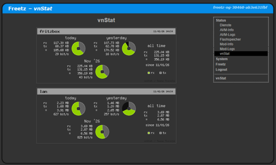

# vnStat 1.18/2.14 (binary only)
  - Homepage: [https://humdi.net/vnstat/](https://humdi.net/vnstat/)
  - Manpage: [https://humdi.net/vnstat/man/](https://humdi.net/vnstat/man/)
  - Changelog: [https://humdi.net/vnstat/CHANGES](https://humdi.net/vnstat/CHANGES)
  - Repository: [https://github.com/vergoh/vnstat](https://github.com/vergoh/vnstat)
  - Package: [master/make/pkgs/vnstat/](https://github.com/Freetz-NG/freetz-ng/tree/master/make/pkgs/vnstat/)
  - Steward: [@fda77](https://github.com/fda77)

### Dark Mode

Dark mode is available only in vnStat 2. When using a dark Freetz skin, enable the transparent background option.

### Migration

Back up `/var/lib/vnstat/` before switching between vnStat 1 and 2.

#### Upgrading From v1 to v2

vnStat migrates the data automatically on startup. Once you have verified the migration, remove the old v1 database files from `/var/lib/vnstat/` and keep `vnstat.db` and `vnstat.db-journal`.

#### Downgrading From v2 to v1

Downgrading is not supported. Restore a v1 backup. Without one, recovery is manual; move `vnstat.db` and `vnstat.db-journal` out of `/var/lib/vnstat/` before attempting it.

